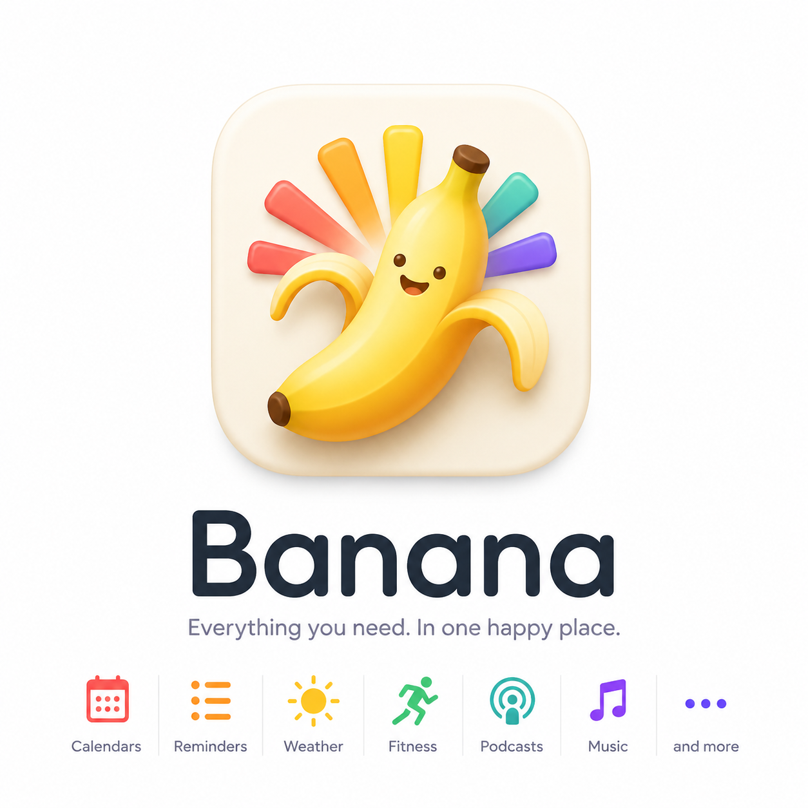

> **Current public site, October 27, 2026:** IBM Plex Mono, cream/ink/yellow/pastels and the
> approved dimensional yellow mascot are current. The static blog and RSS use this identity.
> Workouts/sleep, Food, Notes and Podcasts are optional modules in the main app; Email remains
> unavailable there. Google Calendar also uses Banana's service for alerts, cloud views and
> explicitly approved guest sharing. The historical feature/brand narrative below includes
> superseded privacy and availability statements: verify against released code and the current
> public Privacy Policy before reusing it. Do not copy it as current product documentation.
> `README.md`, `Brand/README.md` and `docs/seo/2026-10-27-review.md` describe current publishing.

# Banana landing-page handoff

Updated: October 9, 2026

This document is the working source of truth for Banana’s landing page: what the
product does, why it matters, how to describe it accurately, and which visual assets
are ready to use.

## The short version

**Brand:** Banana

**Primary tagline:** Everything you need. In one happy place.

**Product sentence:** Banana brings your calendar, reminders, routines, meals, workouts,
sleep, weather, podcasts, and music into one calm daily plan across iPhone, iPad,
Apple Watch, and Mac.

**Core promise:** Stop managing separate apps and mentally reconciling them. Banana
shows the shape of the day, helps the day adapt, and keeps planning, eating, listening,
and movement in context.

**Primary call to action for the current stage:** [Join the TestFlight](https://testflight.apple.com/join/47yxmU8U)

Do not invent an App Store download link, price, testimonial, user count, or launch
date until each is real.

## Brand direction

Use the new cheerful character direction as the visual source of truth:



The useful ingredients in this direction are:

- A friendly peeled banana character, not a generic fruit glyph.
- A fan of product colors behind the character, expressing multiple parts becoming
  one product.
- Warm ivory, yellow, and orange as the base, with coral, teal, purple, and green as
  feature accents.
- An optimistic, approachable personality that offsets the complexity of the
  product.
- The line **“Everything you need. In one happy place.”**

The existing production icon should be treated as legacy for landing-page design.
Do not stretch or crop this brand board into a final app icon. Before public launch,
recreate the new direction as:

- A clean 1024×1024 app-icon master without wordmark or tagline.
- A standalone character mark with a transparent background.
- A horizontal Banana wordmark lockup.
- Light and dark lockups.
- SVG/PDF vector masters where possible.
- Favicon, social avatar, Open Graph, press-kit, and monochrome variants.

The character should feel cheerful rather than childish. Avoid turning the entire
site into a novelty fruit theme; the product UI and copy should remain calm and
capable.

## Who Banana is for

The strongest initial audience is an Apple-device user who keeps their calendar in
Google and whose day is fragmented across Calendar, Reminders, Health, a food log,
podcasts, weather, travel, alarms, and a handful of routines.

Useful audience descriptions:

- People whose calendar shows meetings but not the rest of their life.
- People who repeatedly rebuild the day after plans change.
- People who want to know roughly what they ate without weighing and typing every
  item.
- Podcast listeners who want downloads, progress, transcripts, and listening
  context in one place.
- Apple Watch users who want workouts, sleep, and recovery to inform the week rather
  than disappear into another dashboard.
- People who want a dependable morning, workout, commute, wind-down, or sleep cue.
- People who prefer on-device processing and Apple-native integrations.

Avoid narrowing the entire product to “an alarm clock,” “a podcast app,” “a calorie
counter,” or “a fitness tracker.” Those are meaningful capabilities, but the
differentiation is their shared context.

## The problem Banana solves

Most personal apps know only one piece of the day:

- Calendar knows what was booked.
- Reminders knows what is due.
- Weather knows what is happening outside.
- Maps knows how long travel takes.
- Health knows what the body did.
- A food diary knows what was eaten.
- A podcast player knows what is playing.
- An alarm knows when to make noise.

The user still has to combine all of that mentally. Banana’s job is to make those
pieces legible as one day and one weekly rhythm.

## Benefit pillars

### 1. See the whole day

Google Calendar events, Apple Reminders, routines, weather, travel context, alarms,
and open time appear on a unified planning surface, by day or by week. Events can be
created, edited, repeated, and answered in Banana, and guests added or removed; an
event can be typed the way it would be said (“Lunch with Sam Friday at 1”). Overdue
reminders lead today; a reminder is ticked with its circle (with an Undo) and opened
by its words. On a trip, the hours of the place being travelled to run beside the
user’s own.

**Benefit:** The user sees what is happening, what needs attention, and where time
still exists without cross-checking several apps.

Suggested headline: **One clear plan for your whole day**

Suggested support copy: “Meetings are only part of a day. Banana brings the rest
into view.”

### 2. Build routines that meet real life

Wake, workout, commute, focus, wind-down, sleep, and custom cues can be automatic,
time-based, or attached to real-world triggers such as the first meeting or workout
start. Reminders and supplements can be due around a moment too: after a workout,
before breakfast. A routine that does not start by itself can be started from the
app or by asking Siri.

**Benefit:** Routines behave like part of the schedule instead of a checklist the
user has to remember to open.

Suggested headline: **Routines that adapt to real life**

Suggested support copy: “Start with a cue, connect the right audio, and let the
routine follow the shape of the day.”

### 3. Eat without the bookkeeping

A meal can be logged from a photo, a barcode, a sentence, or a search of the bundled
USDA food database. A package scanned once becomes one of the user’s own foods at
their usual amount. Any amount can be entered in the food’s own measures, grams, or
ounces. Supplements and medication are ticked off beside the meals. The day’s energy
and macros are shown, and past days can be reviewed.

**Benefit:** A usable record of what was eaten for a fraction of the effort a
calorie-counting app asks for.

Suggested headline: **Log a meal in two taps**

Suggested support copy: “Scan it, snap it, or say it. Banana fills in the numbers
and remembers your usual.”

Do not promise accuracy. Estimates are estimates, every number is editable, and photo
or sentence estimates depend on Apple Intelligence being available on the device.

### 4. Listen with context

Banana includes podcast discovery, RSS subscriptions, background playback,
downloads, per-show ordering and speed (on the Watch too), progress, history,
word-timed transcripts that can say who is speaking, written notes, and voice notes
tied to the listening moment.

**Benefit:** Listening becomes something the user can resume, remember, and act on,
not just audio that disappears after it plays.

Suggested headline: **Remember more of what you hear**

Suggested support copy: “Download an episode, follow the words, and capture a thought
without losing where it came from.”

### 5. See movement, sleep, and recovery as part of the week

Banana reads supported Apple Health workouts, sleep, and recovery signals. The
Apple Watch app can record workouts, routes, heart rate, energy, distance, and
motion, pause and resume them, then return the session to the phone and Apple Health.
A workout that ran long can be trimmed on any device, and Apple Health’s copy follows.
A sleep page shows each night and its wake-ups, and Trends compares like periods with
like.

**Benefit:** The user can understand activity, sleep, and recovery beside the
routines, meals, and listening that shaped the same week.

Suggested headline: **See the rhythm behind your week**

Suggested support copy: “Workouts, routes, sleep, recovery, and listening patterns
belong in the same story.”

Do not make diagnostic, treatment, readiness-score, or medical claims.

### 6. Use the right device for the moment

- **iPhone:** the primary daily plan, meal logging, mobile podcast player, history,
  transcripts, workouts, and routine control. The iPhone is the hub for the Watch.
- **iPad:** the same plan, nutrition, workouts, sleep, and library on a larger canvas,
  with layouts that follow the width of the window.
- **Apple Watch:** workout recording with pause and resume, glanceable live metrics,
  offline downloaded podcast playback at the show’s speed, and quick voice-note capture.
- **Mac:** a larger planning surface for the week, plus nutrition, sleep, trends,
  routines, workouts, the podcast library, and playback.

**Benefit:** The product follows the user from wrist to pocket to desk without
pretending every device should have the same interface.

Suggested headline: **From wrist, to pocket, to desk**

## Functionality and honest benefit mapping

| Capability | What it does | User value | Important qualification |
| --- | --- | --- | --- |
| Unified day | Merges meetings, reminders, cues, alarms, and derived schedule items, by day or week | Less mental reconciliation | Calendar events come from Google Calendar; one or more Google accounts must be connected |
| Google Calendar | Reads events and writes them through Google’s API: create, edit, repeat, move, delete, and reply to invitations | Meetings and travel appear in context, and changes made in Banana are real calendar changes | Requires Sign in with Google. Calendars that exist only in iCloud or Outlook are not shown |
| Typed events | Turns “Lunch with Sam Friday at 1” into a filled-in event and suggests the guests named | Adding an event takes a sentence | Guest lookup needs Contacts permission; the form stays editable |
| Cross-calendar availability | Keeps meetings, scheduled work, and travel busy across the user’s Google calendars without copying private details | Scheduling tools and colleagues see the time as taken | On by default once Google Calendar is connected, and can be turned off. Calendars someone else owns only receive blocks if switched on |
| Event guests | Adds or removes guests on an event that already exists, with Google sending the invitations | Changing who is coming doesn’t need the browser | Guests are invited by Google from the user’s account |
| Trip time zone | Shows the hours of the place being travelled to beside the user’s own, for the days of the trip | The day reads right in both places | A trip is recognised from flights on the calendar |
| Smart wake | Can derive wake timing from the first meeting and other schedule context | A morning tied to the actual day | System alarm access is required |
| System alarms | Uses Apple’s AlarmKit | Reliable alarms through Silent Mode and Focus | Requires iOS 26.1+; system limits still apply |
| Start a routine | Starts a routine’s audio on request, from the app or by asking Siri | A routine that can’t start itself is one tap or one sentence away | An app cannot start audio by itself in the middle of the day; only the wake alarm and a Watch workout start routines automatically |
| Routines | Wake, workout, commute, focus, wind-down, sleep, and custom cues | Repeatable dayparts without separate apps | Some triggers require their related permission |
| Apple Reminders | Reads incomplete and due reminders, ticks them off with an Undo, opens one to read it in full, shows overdue ones at the top of today, and lets a reminder be due around a moment | Real tasks can enter the daily plan | Reminders permission is separate from the calendar connection |
| Weather and travel | Uses location, event places, forecasts, and travel estimates | Better leave-by and day context | Forecast and route services require network access |
| Meal logging | Logs a meal from a photo, a barcode, a sentence, or a name search of the bundled USDA database; any amount in the food’s measures, grams, or ounces | A food record without the bookkeeping | Estimates are approximate and editable. Photo and sentence estimates use Apple Intelligence where the device supports it. Barcode lookups use public food databases and need a network connection for products outside the bundled catalog |
| Your foods | A package scanned once is remembered at the user’s usual amount and preferred in later estimates | Repeat foods take one tap | Nutrition comes from the package’s database record and can be corrected by scanning the label |
| Supplements and medication | A “Taken” list ticked off on a schedule or after a moment such as a workout | One place for the day’s doses | A checklist and reminder, not medical advice or adherence monitoring |
| Podcast player | Search, subscribe, stream, download, queue, background play, speed, and ordering | One listening workflow with offline support | Podcasts come from public RSS feeds |
| Listening history | Records listening sessions and, when explicitly enabled, associated locations/routes | Recall where and when an episode was heard | Location recording is permission-based and user-controlled |
| Transcripts | Uses published transcripts or creates word-timed transcripts on device, and can label who is speaking | Follow along and return to exact moments | Downloaded audio is required for generated transcription |
| Voice and written notes | Pauses playback, records or types a thought, transcribes it, and preserves episode/timestamp context | Turn listening insight into something durable | Microphone and speech capabilities are required for voice notes |
| Apple Music | Selects songs, albums, or playlists for supported routine audio | Personal wake or wind-down soundtrack | Requires Apple Music access/subscription; it is follow-on audio, not the system alarm tone |
| Health import | Reads supported workouts, sleep, HRV, resting heart rate, and related trends | A broader view of activity and recovery | Health read authorization is private to iOS and must be managed in Settings |
| Sleep | Shows each night, its stretches awake, and wake-ups | The night in the same place as the day | Read from Apple Health and the Watch; descriptive, not advice |
| Trends | Compares like periods with like across finished days | See whether the week is moving | Needs enough Health history to compare |
| Watch workouts | Records live workout metrics, route, and motion samples, with pause and resume | Workout capture from the wrist | Requires Apple Watch permissions and compatible hardware |
| Trim a workout | Cuts the start or end off a workout on any device, keeps the original to go back to, and rewrites Apple Health’s copy | A forgotten stop doesn’t spoil the record | Apple Health is updated by the iPhone, the next time Banana is open on it |
| Offline Watch listening | Transfers selected downloaded episodes to Apple Watch | Listen without carrying the phone | Transfer is opportunistic and requires downloaded audio |
| iCloud sync | Keeps subscriptions, play positions, history, routines, meals, supplements, and settings in step between the user’s devices | Pick up on another device | Uses the user’s own iCloud account. Downloaded audio is not synced through iCloud |
| iPad app | One adaptive layout that follows the window’s width | The plan and library at tablet scale | The iPhone stays the hub; some phone and Watch actions remain on the phone |
| Mac app | Provides native sidebar navigation, planning, nutrition, sleep, trends, routines, workouts, library, and playback | Review and adjust at desktop scale | Some phone/watch hardware actions remain device-specific |

## Recommended landing-page structure

### Navigation

Logo · Features · iPhone · iPad · Watch · Mac · Privacy · FAQ ·
**[Join TestFlight](https://testflight.apple.com/join/47yxmU8U)**

Keep the navigation restrained. The product breadth should come from the story, not
from a large feature mega-menu.

### Hero

**Eyebrow:** Your day, together

**Headline:** Everything you need. In one happy place.

**Body:** Banana brings your calendar, reminders, routines, meals, workouts, sleep,
weather, podcasts, and music into one calm daily plan—across iPhone, iPad, Apple Watch,
and Mac.

**Primary CTA:** [Join the TestFlight](https://testflight.apple.com/join/47yxmU8U)

**Secondary CTA:** See how it works

**Hero visual:** A cross-device composition led by the iPhone Plan screen, with the
Watch Now Playing screen and Mac Plan screen behind it. Use the new banana character
as a brand accent, not as a replacement for product proof.

### Problem-to-outcome transition

**Headline:** Your apps know the pieces. Banana understands the day.

Use a short sequence showing Google Calendar, Reminders, Weather, Health, a meal,
Podcasts, and Music converging into the Plan screen. Do not claim that Banana replaces those
services; it integrates their useful context.

### Feature story 1: Plan

**Headline:** One clear plan for your whole day

**Copy:** See your Google Calendar, reminders, routines, weather, travel, and open
time in one place. Add an event the way you would say it, invite who is coming, and
tick off what is done.

Visual: `assets/screenshots/iphone/composed/01-plan.png`

### Feature story 2: Routines

**Headline:** Routines that adapt to real life

**Copy:** Build wake, workout, commute, focus, wind-down, and sleep cues around the
events that already shape your day.

Visual: `assets/screenshots/iphone/composed/02-routines.png`

### Feature story 3: Listen

**Headline:** Remember more of what you hear

**Copy:** Download podcasts, follow word-timed transcripts, capture voice notes, and
return to the place and moment where an idea found you.

Visuals:

- `assets/screenshots/iphone/composed/06-listening.png`
- `assets/screenshots/iphone/composed/07-transcripts.png`

### Feature story 4: Nutrition

**Headline:** Log a meal in two taps

**Copy:** Scan a barcode, snap a photo, or type it in. A package scanned once becomes
one of your foods at your usual amount, and supplements are ticked off right beside
the meals.

Visuals:

- `assets/screenshots/iphone/composed/03-nutrition.png`

### Cross-device section

**Headline:** From wrist, to pocket, to desk

**Body:** Start a workout on your wrist. Listen from your pocket. Tune a routine or
review the week from your iPad or Mac.

Show the platforms together, then give each a one-sentence role. Avoid saying
“everything syncs instantly”; different data uses different Apple services and some
Watch transfers are opportunistic.

Visual: `assets/screenshots/iphone/composed/04-continuity.png`

### Privacy section

**Headline:** Personal context should stay personal

Accurate supporting points:

- Banana explains each permission before asking.
- Onboarding skips permissions that are already granted.
- Generated podcast and voice-note transcription runs on device.
- Reminders use Apple’s native framework. Google Calendar is read and written directly
  from the device; Banana has no server of its own in between.
- Meal estimates are made on the device. Barcode scans look a product up in a bundled
  catalog and, when it is not there, in public food databases.
- The meal-photo search of the photo library is off until the user turns it on.
- App state syncs through the user’s own iCloud account.
- Location-based listening history is explicit and permission-controlled.

Do not say “we collect no data” until the final privacy policy and App Store privacy
answers have been reviewed against every framework and service.

### Final CTA

**Headline:** Give your day one home.

**Body:** Join the Banana TestFlight and help shape the first release.

**CTA:** [Join the TestFlight](https://testflight.apple.com/join/47yxmU8U)

Add a short compatibility line nearby: iPhone or iPad with iOS 26.1 or later. Apple
Watch and Mac experiences require compatible devices and current operating systems.
Calendar features need a Google account.

## Alternative headlines

Use these as testable options, not all at once:

1. **Everything you need. In one happy place.**
2. **Your whole day, finally together.**
3. **One clear plan for real life.**
4. **Your day has a lot of moving parts. Banana brings them together.**
5. **Plan, listen, move, and recover—in one place.**

The first option is the recommended brand-led hero. The second and third are useful
conversion-test alternatives with a more immediate product outcome.

## Screenshot pack

The folder includes both composed marketing screenshots and untouched UI captures:

Quick contact sheets:

- [iPhone overview](assets/screenshots/contact-sheets/iphone.png)
- [iPad overview](assets/screenshots/contact-sheets/ipad.png)
- [Mac overview](assets/screenshots/contact-sheets/mac.png)
- [Apple Watch overview](assets/screenshots/contact-sheets/watch.png)

```text
assets/screenshots/
  iphone/
    composed/   7 captioned 1320×2868 images
    raw/        7 untouched app captures
  ipad/
    composed/   6 captioned 2064×2752 images
    raw/        6 untouched app captures
  mac/
    composed/   5 captioned 2880×1800 images
    raw/        5 untouched app captures
  watch/
    composed/   3 captures at 416×496
    raw/        same 3 untouched Watch captures
```

Every set dates from October 9, 2026, from the code of build `1.0 (54)`. They show one sample
day and week made for these captures: the same at any hour of the run, each event on a
calendar with its own colour, a reminders line, an all-day event, and travel time.

### Strongest assets available now

- iPhone Plan (`01-plan`): the Plan tab’s Day view as it ships: meetings in their
  calendars’ colours, a commute, a focus block, reminders on the grid and in the line
  above it (one overdue), an all-day event, travel time, and the now line.
- iPhone Nutrition (`03-nutrition`): the Food tab with a logged meal, the day’s energy and
  macros, and the four ways to log.
- iPhone Continuity: real iPhone, Mac, and Watch UI in one cross-device story.
- iPhone Routines: clear capability and good density.
- iPhone Listening Map: visually distinctive and easy to understand.
- iPhone Workouts: sleep, the latest workout, and trends, with the Watch’s live metrics.
- iPad Plan (`01-plan`): the whole week on one grid, the strongest single image of the
  planner at size.
- iPad Workouts (`03-workouts`): the week’s workouts in one table, with its totals
  compared with the week before.
- iPad Library (`06-library`): the shows as a grid of artwork.
- iPad and Mac Sleep: last night in words, the wake-ups, and the fortnight.
- Mac Plan, Nutrition, Routines, Library: the real window, sidebar included.
- Watch Now Playing: strong, legible, and directly connected to the podcast story.
- Watch Workout Picker: clear evidence of wrist-native workout selection.

### Recapture before a public launch

- **Workout detail on iPad and Mac:** not in either set. The sample workout shows
  “Summary only” and a coarse-route note, and its numbers disagree with each other
  (three hours long, nine hours moving). Fix the sample before photographing it.
- **Trends:** no screenshot of its own yet.
- **Routines (iPhone and iPad):** the first card reads “Wake & bedtime: Off”, which is
  how a new install starts. A capture with it on would suit the headline better.
- **iPhone Transcript:** replace repetitive demo prose with a natural, readable excerpt
  from cleared demo audio.
- **Watch assets:** create captioned landing-page compositions; the present files are
  raw App Store-size Watch captures.
- Consider a closer feature crop of Mac screens for the website, because the full-window
  UI becomes small at ordinary browser widths.

Keep data obviously demonstrative but internally consistent. Do not fabricate
testimonials, medical outcomes, performance gains, or battery claims. Never use a
capture that shows a red “not connected” row, an error state, or a real person’s name.

## Suggested screenshot sequence

For the landing page:

1. Cross-device hero: iPhone Plan + Watch Now Playing + Mac Plan.
2. iPhone Nutrition.
3. iPhone Routines.
4. iPhone Listening Map.
5. iPhone Workouts + Watch Workout.
6. iPad Plan or Mac Library.
7. iPhone Transcript after recapture.

For a nutrition-focused campaign:

1. iPhone Nutrition.
2. iPhone Plan.
3. iPhone Workouts.

For a podcast-focused campaign:

1. iPhone Listening Map.
2. iPhone Transcript.
3. Watch Now Playing.
4. Mac Library.

For a fitness-focused campaign:

1. iPhone Workouts.
2. Watch active workout.
3. iPad Workouts.
4. iPad or Mac Sleep.

## FAQ copy

### Does Banana replace my calendar?

No. Banana connects to Google Calendar and shows your events with reminders,
routines, travel, weather, and the rest of the day. Events you add or change in
Banana are saved to Google Calendar.

### Which calendars does it work with?

Google Calendar. Sign in with Google and add as many accounts as you use. Calendars
that live only in iCloud or Outlook are not shown.

### Does Banana write to my calendar?

Yes, in two ways. Events you create or edit in Banana are real Google Calendar
events. And once connected, Banana keeps your time busy across your own Google
calendars, so a meeting on one calendar blocks the same time on the others without
copying its details. That is on by default and can be turned off in Settings.

### How does meal logging work?

Photograph a meal, scan a barcode, type what you ate, or search for a food by name.
Banana fills in the amounts and nutrition from the package’s record or a bundled USDA
database, and you can change any of it. Estimates from a photo or a sentence use
Apple Intelligence where your device supports it.

### Can I listen offline?

Yes. Podcast episodes can be downloaded on iPhone, and selected downloaded episodes
can be transferred to Apple Watch.

### Are transcripts sent to a server?

Banana can use a transcript published by the podcast or generate a word-timed
transcript on the device.

### Does Banana replace Apple Health?

No. Banana reads supported Health data to add context and saves workouts recorded
with the Banana Watch app back to Apple Health.

### Why does Banana need location?

Location supports local weather, travel estimates, workout routes, and—only when
explicitly enabled—location context for listening history.

### What syncs between my devices?

Podcast subscriptions, listening positions and history, routines, meals,
supplements, and settings sync through your own iCloud account. Downloaded audio is
not synced through iCloud.

## Claims to avoid

Do not use these without new evidence or a product change:

- “AI-powered”
- “Automatically organizes everything”
- “Never miss anything”
- “Zero battery drain”
- “Medical-grade,” “recovery score,” or health recommendations
- “Personal trainer,” workout plans, form checking, injury recovery, or rehabilitation:
  Banana records and shows workouts, it does not prescribe them
- “Works with every calendar”: Banana works with Google Calendar
- “Counts calories from a photo” without the Apple Intelligence qualification, or any
  claim that estimates are accurate or precise
- Medication management, adherence, or dosing claims: “Taken” is a checklist
- “All data syncs instantly”
- “Fully offline” for the entire product
- “Private by default” as a substitute for specific privacy explanations
- “Replaces Calendar, Reminders, Podcasts, Health, or Music”

## Decided

- App Store subtitle (October 6, 2026): “Podcasts, fitness, food, sleep”. The earlier
  “Podcasts, fitness & routines” predated nutrition and sleep. `routine` moved to the
  keyword field.
- Guided plans are not marketed (October 9, 2026). They were switched off in the app on
  October 8 and taken out of the store description, the capability table, the FAQ, and
  the iPad screenshots. So were Re-plan, the List view of Plan, and the bedside clock.

- Google sign-in (October 9, 2026): Google approved the OAuth consent screen, so the
  public can connect a calendar without a warning screen.
- Website (October 9, 2026): built from this brief in `site/`, one static page on
  Cloudflare Workers for bananatheapp.com (`README.md` says how to change and publish it).
  `check_site.py` holds its copy to the rules in this file before every deploy.

## Open marketing decisions

- Final public tagline: retain the new “Everything you need. In one happy place.”
  direction or keep “Everything. Organized.” as a secondary line.
- Whether podcast ad skipping is marketed at all. It ships and is on by default, but
  it is not mentioned in the store copy or on this page.
- Public availability: TestFlight is the current public channel; the App Store launch
  date remains undecided.
- Pricing and business model.
- Final support, privacy-policy, and marketing URLs.
- Final brand master and trademark/domain clearance for “Banana.”
- Whether location-based Listen History is a lead feature or a delightful secondary
  reveal.
- Whether the first conversion test leads with planning breadth, nutrition, or the
  more visually distinctive podcast experience.

