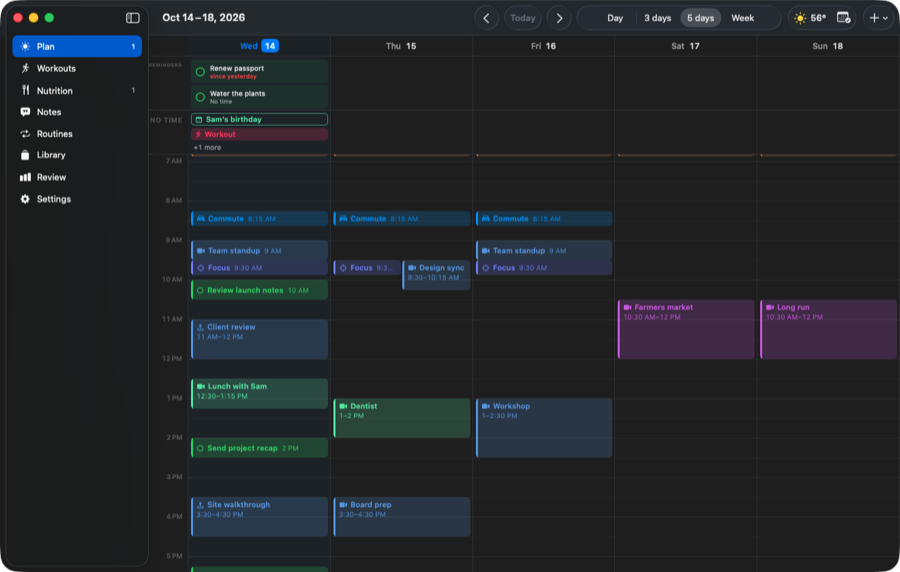
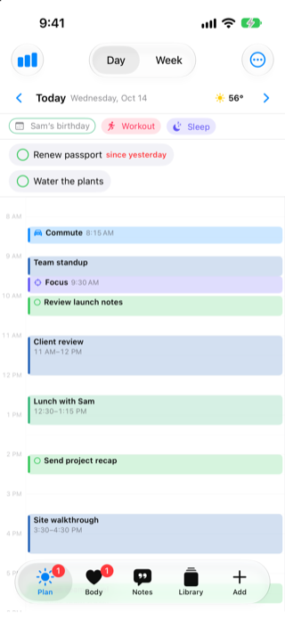
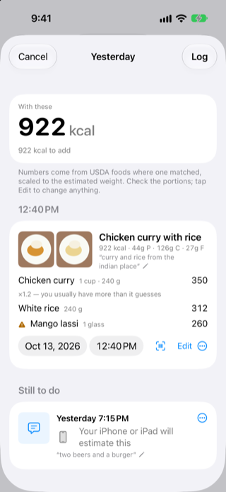
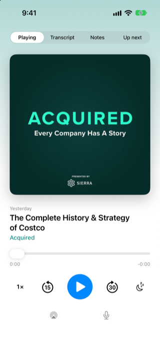
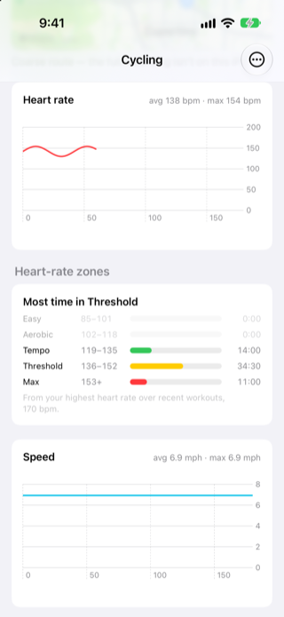

# Banana

Banana borrows its speed from **Superhuman** and **Vimcal**: keyboard-first, built for
someone who lives in it all day. Those two live in one inbox or one calendar; Banana
covers your whole day, and we're building toward an agent that can act on it directly,
the way a coding agent acts on a codebase, instead of a chatbot bolted on top.

It brings your calendar, reminders, routines, meals, workouts, sleep, weather, and
podcasts into one plan, on iPhone, iPad, Apple Watch, and Mac.








## What it does

- **Plan:** Google Calendar, Apple Reminders, routines, weather and travel time on one
  timeline, by day or by week. Alarms use Apple's **AlarmKit**, so they ring through
  silent mode and Focus, even when the app is closed.
- **Nutrition:** meals from a photo, a barcode, a sentence or a search of the bundled
  USDA food database, with supplements and medication ticked off beside them.
- **Listen:** a podcast player with downloads, on-device transcripts and voice notes,
  and Apple Music as a wake source.
- **Move and sleep:** workouts recorded on Apple Watch, Apple Health trends, and each
  night's sleep.

## Try it

The public beta is on TestFlight: https://testflight.apple.com/join/47yxmU8U

## Contributing

Bug fixes and performance fixes are the contributions we want most. Open an issue,
wait for a maintainer to label it `approved` and assign it to you, then open a PR that
closes it. UI and UX changes are different: design and product decisions get made in
the issue, before any code exists, not in the diff. Anything that touches data
collection, storage, or what leaves the device should default to the more protective
option, even when it's more work. Banana's own feedback reports are the model: they're
useful because they're detailed, and scrubbed before they leave the device.

See [CONTRIBUTING.md](CONTRIBUTING.md) for the full process, including the CLA every
contribution needs.

## License

Native clients and shared code are **GPL-3.0-only** ([LICENSE](LICENSE)); the cloud
service and browser app are **AGPL-3.0-only** ([Service/LICENSE](Service/LICENSE)).
[LICENSING.md](LICENSING.md) has the path-level scope, third-party exceptions, and the
separate treatment of the name and artwork. Dependencies and data retain their own
terms, recorded in [NOTICE.md](NOTICE.md).

Official App Store and TestFlight distribution permissions are a separate publication
review item; the public source licenses alone do not establish those permissions. See
[the publication checklist](docs/publication/readiness.md).

## Building it yourself

```sh
brew install xcodegen
xcodegen generate        # writes Banana.xcodeproj from project.yml
mkdir -p Banana.xcodeproj/project.xcworkspace/xcshareddata/swiftpm
cp Config/Package.resolved Banana.xcodeproj/project.xcworkspace/xcshareddata/swiftpm/Package.resolved
open Banana.xcodeproj    # scheme Banana, any iPhone simulator
```

`Config/Package.resolved` preserves the reviewed direct and transitive package
revisions outside the generated project. Copy it again after regenerating the project;
review dependency upgrades and refresh notices together.

That is enough for a simulator. The build uses the stand-in names in `Config/Base.xcconfig`:
it runs on sample or local data, with iCloud sync and Google sign-in switched off, because
both belong to whoever signs the app.

Use **Try with sample data** on the welcome screen to explore the native demo
without Google credentials or personal data. The cloud service has its own
[setup and test instructions](Service/README.md).

For your own devices, copy `Config/Local.example.xcconfig` to `Config/Local.xcconfig`
(not tracked) and give it:

- **Your Apple developer team and a bundle id prefix you own.** The app uses iCloud,
  HealthKit, WeatherKit, time-sensitive notifications and push, so it needs a paid developer
  account; a free one cannot sign those.
- **An iCloud container**, `iCloud.<your bundle id>` unless you name another, created under
  your team. Devices signed by you sync with each other through it, and with nobody else.
- **A Google OAuth client id** of type iOS for your bundle id, if you want Google Calendar.
  Without one the app has no Google sign-in.

`tools/ios-install.sh` and `tools/mac-install.sh` build Release and install over the app on
a device; they stop when there is no `Config/Local.xcconfig`. `tools/ui-tests.sh` runs the
UI tests in a simulator with or without one.

### Requirements

- Xcode 27.1 (validated for this source snapshot) and an Apple silicon Mac. Native Mac builds target arm64 only.
- An iPhone or iPad running **iOS 26.1 or later**.
- **The watchOS platform installed in Xcode** (Settings → Components → watchOS). The app
  embeds a Watch app, so the whole project won't build without it.
- An **Apple Watch** to record/test fitness data (HealthKit workouts, motion, GPS don't
  work in the Simulator).
- A physical iPhone to test ringing (alarms don't fire in the Simulator).
- Optional: an **Apple Music subscription** for the Apple Music wake source, with
  **MusicKit enabled** for the App ID (see [feature notes](docs/features/alarm-podcast-fitness.md)).

### Build & run on your iPhone

1. Regenerate the Xcode project (only needed if you change `project.yml`):
   ```sh
   xcodegen generate
   ```
2. Open it:
   ```sh
   open Banana.xcodeproj
   ```
3. Set signing: select the **Banana** target → *Signing & Capabilities* → pick your
   Apple ID team. Do the same for the **BananaWidgetExtension** target. The full app capabilities require a paid
   Apple developer account; see the configuration steps above.
4. Plug in your iPhone, select it as the run destination, and press ▶.
5. First launch: tap **"Allow alarms to wake you"** and grant the permission.
6. Toggle on a few times and lock the phone to test.

More on the alarm tone, wake sources, podcasts, Apple Music, and Watch fitness
recording: [docs/features/alarm-podcast-fitness.md](docs/features/alarm-podcast-fitness.md).

## Project layout

| Path | What's there |
| --- | --- |
| `Banana/`, `BananaWidget/` | iPhone/iPad app and its Live Activity/widget |
| `BananaMac/` | Mac app |
| `BananaWatch/`, `BananaWatchWidget/` | Watch app and its widget |
| `Shared/` | Model and sync code used by every native client |
| `Service/` | The cloud service and browser app (Cloudflare Workers); see [Service/README.md](Service/README.md) |
| `LandingPage/` | The marketing site |
| `project.yml` | xcodegen project definition for all native targets |
| `docs/` | Design, performance, publication, and feature documentation |
| `tools/` | Build, install, test, and generator scripts |

## UI performance requirements

The [UI performance contract](docs/performance/ui-performance-contract.md) defines the required
8.3 ms frame budget, direct-manipulation latency, 32–50 ms UI response goals, and strict 100 ms
ceiling, including caching, preloading, and durable optimistic-action requirements.

Performance changes must follow the [persistent regression testing protocol](docs/performance/regression-testing.md).
