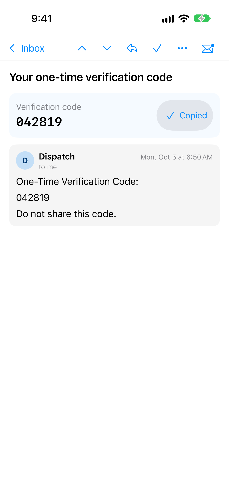

# Verification codes in Mail

A compact card below the subject exposes a verification code and one Copy code action on iPhone, iPad and Mac. Copied appears immediately in the same control. The card uses native adaptive SwiftUI layout and the existing clipboard path, with a 44-point touch target, selectable monospaced code, and digit-by-digit accessibility reading. Narrow widths and large text can place the action below the code. This applies proximity, recognition and prompt feedback without a new menu.

Detection uses prepared visible text on the reader's existing background preparation path. It considers only the newest incoming, non-draft message; a newer reply or unrelated message clears the old result. Subject-only codes are eligible only for single-message conversations, since a thread subject can belong to an older message. Generation checks reject late reads. The code can appear before older bodies finish loading. Ready bodies and unchanged headers reuse their prepared result, scoped to the message, subject and body state; no new persisted code cache or logging is introduced.

The extractor requires authentication wording, preserves leading zeros and case, and supports 4–10 digit codes, grouped digits, mixed alphanumeric codes and explicitly introduced uppercase word codes. Instructions can anchor codes after device metadata; generic code wording requires authentication context. Meeting passcodes, referral and promotional codes do not qualify through generic wording. Link-only actions cannot supply code payloads. Conflicting candidates suppress the card. Quotes, forwarded subjects, pictures and URLs do not supply codes. Small-print styling can contain a real code, but still requires the same authentication and instruction rules. Work is bounded to 16,384 characters, 256 prepared blocks and 2,048 text runs. Unsupported or ambiguous messages remain readable and selectable normally; the card does not attest sender authenticity or code validity.

Apple's [one-time code APIs](https://developer.apple.com/documentation/security/one-time-codes) describe entry/AutoFill, while the public [DataDetector entity types](https://developer.apple.com/documentation/datadetection/datadetector) do not include OTP extraction from an email body. A small Foundation text extractor fills that gap while reusing native layout and clipboard APIs. No HTML parser, model, remote request or authentication SDK is added.

Correctness cases cover ambiguity, leading zeros, unrelated numeric identifiers, grouped and mixed codes, quoted/forwarded mail, designed mail's prepared text, bounded input, stale results and reader cache behavior. Phone and iPad journeys cover position, reachability and one-click feedback; large-text/dark appearance is also exercised. Retained component samples measure extraction separately from UI/frame acceptance. Physical frame/input acceptance and Mac visible interaction require their own evidence.

A read-only replay of the local prepared-message cache exercises the production Swift extractor. Private messages, addresses and actual codes remain in ignored private evidence; public regression fixtures use synthetic content. Broad candidate searches guide template review and do not establish complete OTP ground truth. The cached preparer version and source-file digest accompany the replay results.
