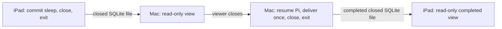

# Closed-store Pi handoff: physical iPad → Mac → iPad

A controlled transfer now passes using the exact upstream Pi SQLite store and extension task definition. The physical iPad creates a sleeping task and closes; Mac reads it without executing it, becomes the sole writer and delivers it once; iPad then reads the completed result without executing anything.

This is a portability and exclusive-transfer proof. It does not implement automatic synchronization, device discovery, owner election, fencing or failover.

## Verified flow



All steps use native JavaScriptCore and SQLite. The same task ID, kind, version, input and checkpoint travel in Pi's own database. The task is installed with `defineExtension` / `defineTask`. Both writable hosts use `ApplePiSession`; viewers use the public `HarnessOptions.readOnly` setting.

The physical iPad's first process executes the arm phase once and delivery zero times, then exits with zero Pi-owned database handles, timers or model requests. Only after that exit does the runner copy the database to a temporary Mac directory.

The Mac viewer sees the stored sleeping checkpoint. Calling `resume()` and committing a new task both reject with upstream `ReadOnlySession`; no task phase or wake callback runs. The database SHA-256 is identical before and after this view.

The Mac writer then opens the copied store, resumes the existing task and completes only its delivery phase. It uses the real epoch clock and does not deliver before the iPad's persisted deadline. After the writer exits, the runner imports the completed file under a fresh proof-app path on iPad. That iPad viewer sees the exact completed record and runs neither phase. Exporting that view gives the same SHA-256 as the completed Mac file.

Evidence: [summary and hashes](pi-apple-host-results/ipad-mac-handoff.json), [source iPad](pi-apple-host-results/ipad-handoff-first.json), [Mac viewer](pi-apple-host-results/mac-handoff-viewer.json), [Mac completion](pi-apple-host-results/mac-handoff-resume.json), [returned iPad viewer](pi-apple-host-results/ipad-handoff-completed.json), [transcript](pi-apple-host-results/ipad-mac-handoff.console.txt).

## Ownership boundary

The test runner provides exclusive ownership by waiting for each writer to exit before transferring or opening the next writer. It copies closed stores, not a live WAL database. The source's original test snapshot remains inactive and is not reopened as a writer; the returned result uses a new path.

That orchestration is not a durable ownership protocol. Production must prevent an old owner from continuing after handoff, and coordinate storage-version and extension-definition compatibility. Pi's `readOnly` setting supplies a supported viewer boundary; it does not supply network fencing. The host should integrate an established ownership mechanism around Pi rather than change its scheduler or merge independently written SQLite histories. No such mechanism has been selected or invented in this proof.

Wake hints are not transferred as task state. The destination recomputes them through `harness.wake()` from Pi's database. Both hosts use real epoch time for this transfer; the separate lifecycle test that advances a controlled clock is not used here.

## Reproduce

Build/install the current standalone Pi proof app on the selected iPad, generate the host bundle and run:

```sh
python3 tools/pi-host-proof/run-handoff.py <device-udid>
```

The runner compiles one temporary Mac executable in `.build/mac-check`, uses temporary transfer databases, and removes both afterward. Results remain under `docs/research/pi-apple-host-results`. It operates only the separate proof app's synthetic task data. No phone operations, production Banana stores, main/Beta installs or Apple submissions are involved.
